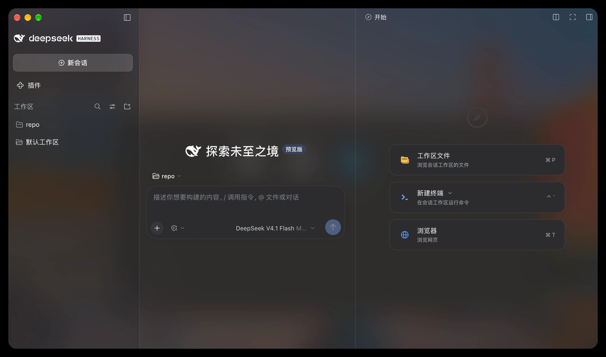

# dsh-plugin-ui-tweak

DSH 界面微调：半透明、毛玻璃模糊、界面缩放。
纯样式插件，不碰数据；macOS / Windows 同一份代码，没有任何平台分支。



## 安装

```sh
dsh plugin --profile desktop add github:Yookio-Z/dsh-plugin-ui-tweak
```

装完**完全退出 DSH 再打开**。

卸载：

```sh
dsh plugin --profile desktop remove dsh-plugin-ui-tweak
```

## 设置

**设置 → 通用**（往下滚），改完即时生效、自动保存：

| 设置行 | 出厂值 | 说明 |
| --- | --- | --- |
| 背景透明度 | `100%` | 调低 = 主背景半透明，透出窗口后面的桌面 / 系统毛玻璃 |
| 面板透明度 | `100%` | 卡片、侧栏、浮层的不透明度 |
| 模糊强度 | `24 px` | 半透明时背后那层的模糊程度，`0` = 不模糊 |
| 放大态底色 | `100%` | 点右上角放大后右侧面板会铺满整个窗口；`100%` = 实心（背后正文看不到），调低会让背后的对话透上来 |
| 界面缩放 | `100%` | 整个界面（含文字与间距）的缩放，`100%` = 不缩放 |
| 恢复默认 | — | 上面五项还原成出厂值 |
